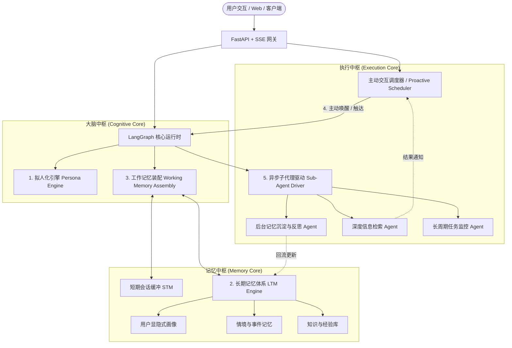
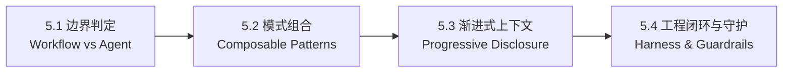

# MaoWu Agent 需求分析与系统设计规范 (GEMINI.md)

---

## 1. 项目愿景与定位

**MaoWu Agent** 是一个基于现代 Agent Runtime（FastAPI + LangGraph + DeepSeek-V4-Pro）构建的**拟人化伴随式智能体**。
**核心业务定位**：**职场与技术成长教练（Tech & Career Growth Mentor / Companion）**。
它不是冷冰冰的代码生成器或打卡脚本，而是一位**亦师亦友、懂技术痛点、具备全局视野的技术 Mentor 与职业发展同行者**。专注于技术探讨、目标推进（OKR/学习规划）、故障与方案复盘、职场瓶颈启发及个性化技术资产沉淀。

其核心设计哲学为：
- **有人味（拟人化导师感）**：沉稳、敏锐、务实有启发性，懂工程师的熬夜与技术卡壳苦恼，能精准共情职场焦虑与攻坚成功的兴奋，杜绝套话空话。
- **能记住（技术成长长期记忆）**：持久记住用户的技术栈演进、正在负责的核心系统架构、短期攻坚难点、历史踩坑日记与职业晋升目标。
- **想得清（工作记忆装配）**：在有限的上下文窗口中，根据当前技术议题动态装配“历史踩坑记录 + 业务系统背景 + 关联技术知识点 + 未竟排障现场”。
- **知主动（敏捷追踪与复盘关怀）**：具备敏捷站会与复盘心跳，适时主动询问昨日卡点、周五复盘引导、重要面试/发版节点前的主动鼓励与注意事项提醒。
- **能做深（异步子代理驱动）**：主 Agent 专注于人机对话与启发式探讨；耗时的架构调研、开源方案深度对比、对话后的复盘总结与知识卡片抽取交由后台异步子 Agent 并发处理。

---

## 2. 核心功能需求分析



---

### 2.1 模块一：拟人化系统 (Personification & Persona Engine)

#### 2.1.1 需求目标
打造具有人格一致性、情绪感知力与自适应关系的伴随式智能体，打破“机械化助手”的固有模式。

#### 2.1.2 核心需求规范
1. **人格特征三层体系**：
   - **底层基座（Core Traits）**：基础性格（如温和、略带俏皮、思维缜密、注重细节）、世界观、不可逾越的行为红线。
   - **中层情绪（Emotional State）**：具有随对话演变的动态情绪度（例如：从平淡、开心、关切、到疲惫感模拟），受交互内容与历史正负反馈影响。
   - **顶层关系（Relational Dynamics）**：与特定用户之间的“羁绊值/亲密度阶梯”，随着交互轮数与共情事件逐渐提升，对话称谓与开放程度随之自然调整。
2. **语言与表达拟人化**：
   - **口吻自适应**：避免八股文式长段落、避免机械式“好的，作为人工智能我建议...”，采用符合人类口语节奏的分句表达。
   - **打字延时与微表情拟真**：流式输出配合呼吸感断句，支持表情、拟声词或行为动作标记（如 `*托腮思考*`、`*会心一笑*`）。
3. **共情与情感识别**：
   - 能够精准识别用户输入中的潜在情绪（焦虑、沮丧、喜悦、自嘲、无聊），优先做情绪抚慰，而非一味给解决方案。

---

### 2.2 模块二：长期记忆体系 (Long-Term Memory, LTM)

#### 2.2.1 需求目标
实现跨 Session、跨周期的多维记忆持久化，让 Agent 拥有“见证彼此生活”的时光积累感。

#### 2.2.2 核心需求规范
1. **多维记忆分类**：
   - **用户属性画像（User Profile / Entity Graph）**：基础属性、职业、爱好、作息习惯、重要关系人、禁忌与敏感点（如不吃香菜、备考阶段等）。
   - **情节记忆（Episodic Memory）**：按时间轴沉淀的事件日记（如“上周三面试了一家自动驾驶公司”、“昨晚感冒发烧”）。
   - **语义/偏好记忆（Semantic & Preference Memory）**：用户独特的认知模式、沟通偏好、专业知识沉淀。
2. **记忆全生命周期管理**：
   - **抽取（Extraction）**：利用低延时模型从单轮或会话片段中静默抽取事实与实体关系。
   - **合并与去重（Consolidation）**：新旧信息冲突时进行版本演进（例如：用户从“单身”变为“正在恋爱中”）。
   - **反思（Reflection）**：低峰期由后台子代理执行，根据最近若干天的离散事件提炼高层次画像与行为结论。
   - **遗忘曲线与权重衰减**：重要生活转折持久保留，细碎无意义信息随时间推移降低检索权重。

---

### 2.3 模块三：工作记忆装配引擎 (Working Memory Assembly, WMA)

#### 2.3.1 需求目标
在模型有限且宝贵的上下文窗口（Context Window）中，针对当前输入瞬间动态构建最精准、最高密度的上下文工作台。

#### 2.3.2 核心需求规范
1. **记忆装配管道（Pipeline）**：
   - **意图与时空提取**：提取当前对话发生的时间戳、当前物理/心理语境。
   - **动态记忆召回**：通过混合检索（关键词 BM25 + 向量语义检索 + 图实体关联）定向拉取 Top-K 相关历史事实。
   - **临时工作台（Scratchpad）**：记录当前多步任务未完成的状态、暂存信息与代办队列。
2. **Token 预算与分级剪枝机制**：
   - 建立严格的预算控制（例如保留 20% 给 Persona 核心提示，30% 给历史相关记忆与画像，35% 给最近对话窗口，15% 给当前输出）。
   - 超限时自适应压缩：优先摘要历史对话轮次，保留关键实体信息。

---

### 2.4 模块四：主动对话机制 (Proactive Conversation Engine)

#### 2.4.1 需求目标
赋予 Agent 自主行为意识，使之具备类似真人的“偶尔想起你”、“适时提醒”、“随心关怀”的能力。

#### 2.4.2 核心需求规范
1. **多模态触发源（Trigger Sources）**：
   - **定时心跳（Time / Cron）**：早晚问候、特定日程时间点（如重要考试前 1 小时、服药提醒）。
   - **事件驱动（Event-Driven）**：后台子代理抓取到外部事件变化（天气剧变、关注的信息发生更新、长任务执行完毕）。
   - **静默/空闲超时（Inactivity Timeout）**：用户多天未互动且存在未完结事件时，适度主动跟进（如“上周说的那个项目进展顺利吗？”）。
2. **主动意愿决策（Proactive Intention Decider）**：
   - 不是到点必发，而是经由 LLM 结合用户作息、当前状态、上次对话结束情绪进行综合评分。
   - **防打扰与冷却（Cooldown Guard）**：设定每日主动上限（如每日不超过 1-2 次），设定静默免扰时段（如 23:00 - 08:00）。

---

### 2.5 模块五：异步子代理驱动架构 (Asynchronous Sub-Agent Architecture)

#### 2.5.1 需求目标
实现主响应通路与后台繁重计算的彻底解耦，保障前端对话实时极速响应的同时，具备深度多智能体协作能力。

#### 2.5.2 核心需求规范
1. **主从分工机制（Master-Worker Topology）**：
   - **主交互 Agent (Persona Main Agent)**：保持极轻负载，仅负责接收用户输入、情感交流、即时工作记忆调度与流式输出。
   - **后台子 Agent 矩阵 (Sub-Agent Matrix)**：
     - *Memory Consolidator*：异步归纳整理上下文，写入长期记忆库与反思总结。
     - *Deep Researcher*：处理复杂资料收集、网页分析、代码解析等耗时操作。
     - *Proactive Monitor*：定时巡检提醒事项与外部事件。
2. **异步通信与回流机制**：
   - **任务派发**：主 Agent 遇到重任务时，调用工具发出异步 Task Ticket。
   - **事件总线（Event Bus）**：基于内存队列/异步任务管理器驱动。
   - **结果回流与动态通知**：子代理完成后，结果持久化入工作台或通知主动对话模块，在合适时机自然告知用户。

---

## 3. 技术栈与环境规范

| 层次 | 选型 | 备注 |
| :--- | :--- | :--- |
| **编程语言** | Python 3.12+ | 已配置虚拟环境 `.venv` |
| **运行时框架** | FastAPI + LangGraph + Uvicorn | 基于异步事件流与状态图架构 |
| **核心大模型** | DataGrand DeepSeek-V4-Pro / Flash | 支持 OpenAI 协议的统一调用 |
| **流式推流** | Server-Sent Events (SSE) | 支持实时 Token 与生命周期事件推流 |
| **持久化存储** | SQLite / Postgres (SQLModel) + JSON | 支撑 Thread 历史与 Checkpoints |
| **向量检索库** | ChromaDB / FAISS / Qdrant-client | 用于长期记忆语义向量存储与检索 |

---

## 4. 系统演进与实施路线图

```text
阶段一：基础架构与记忆底座 (Phase 1: Foundation & Memory Base)
  ├── 1.1 明确数据模型设计（MemoryItem, UserProfile, PersonaState）
  ├── 1.2 实现长期记忆存储与混合检索器（LTM Service）
  └── 1.3 搭建工作记忆装配器（Working Memory Assembler）

阶段二：拟人化引擎与主流程接入 (Phase 2: Persona & Context Pipeline)
  ├── 2.1 注入拟人化 Persona 状态与 Prompt 模板
  ├── 2.2 LangGraph 编排重构：集成 WMA 前置节点与响应后置沉淀节点
  └── 2.3 验证流式 SSE 协议下的情绪拟真对话

阶段三：异步子代理系统 (Phase 3: Sub-Agent Engine)
  ├── 3.1 搭建轻量级异步任务派发中心（Task Dispatcher）
  ├── 3.2 实现记忆提炼与反思子代理（Background Reflector Agent）
  └── 3.3 实现深度研究与外部执行子代理（Research Worker Agent）

阶段四：主动对话与感知循环 (Phase 4: Proactive Loop)
  ├── 4.1 搭建主动事件调度器（Cron & Event Triggers）
  ├── 4.2 接入意图评估与防打扰冷却机制
  └── 4.3 贯通主动唤醒通道（Web / 推送通知）
```

---

## 5. 现代 Agent 标准工程开发规范 (Standard Agent Engineering Practice)

本项目遵循业界前沿（Anthropic *Building Effective Agents* 与开源高星 Agent 架构实践）的工程标准：



### 5.1 架构分层准则：Workflow vs. Agentic Loop 边界
- **坚决避免“过度 Agent 化”**：能用确定性代码、固定路由或静态函数编排解决的链路（如鉴权、数据格式化、静态检索），严格设计为确定性工作流（Workflow），保障低延时与高稳定性。
- **动态循环受控**：仅在开放式意图理解、复杂技术方案多步推演、故障排查深挖等需要动态决策的环节，才引入 LLM Agent 的循环状态机（StateGraph）。

### 5.2 核心组合设计模式（Composable Patterns）
在 LangGraph 图编排中，严格遵循以下 5 种组合模式：
1. **Routing（意图路由）**：前置节点第一时间进行意图判别（技术解惑 / 踩坑复盘 / 深度调研 / 情感倾诉 / 闲聊），派发至不同处理通路。
2. **Orchestrator-Workers（主从协调器）**：前台 Main Agent 担任主教练与协调器，向后台 Worker 子代理下发专项工单（如技术选型调研、开源源码解析）。
3. **Parallelization（并发执行）**：针对多源技术资料搜集、跨模型对比，采用异步并发（asyncio.gather / 并行图分支）缩短响应总耗时。
4. **Evaluator-Optimizer（评估反思环）**：在知识沉淀与方案产出后，由评估节点对答案进行可用性与风险自审，迭代优化后再输出或入库。
5. **Prompt Chaining（链式处理）**：工作记忆装配 $\to$ 核心思考推理 $\to$ 记忆增量抽取，前后状态解耦衔接。

### 5.3 渐进式上下文加载与工具集成准则 (Progressive Disclosure)
- **渐进式披露（Progressive Disclosure）**：严禁无节制将全量历史和全部知识库塞入单次 Prompt。采用动态按需加载：当前 Query $\to$ 关键词/语义召回 $\to$ 注入 Top-K 核心记忆片段。
- **大小模型分级协同（Model Tiering）**：
  - **轻量快速级（DeepSeek-Flash / Flash-Lite）**：承担意图路由、关键词提取、会话记忆静默抽取、后台巡检打分。
  - **深度思考级（DeepSeek-V4-Pro）**：承担主交互对话、复杂架构探讨、故障根因分析与代码生成。
- **工具调用（Tool Calling）鲁棒性**：所有暴露给 LLM 的工具均须具备 Pydantic 强类型入参校验、完善的异常捕获与友好降级提示，禁止未捕获异常导致 Graph 崩溃。

### 5.4 工程底座与闭环守护机制 (Harness Engineering & Guardrails)
- **防死循环与迭代熔断**：在 LangGraph 状态机中设置硬性最大步数限制（`max_iterations`，默认 10 步），防止工具调用发生振荡或死循环。
- **状态持久化隔离**：会话级（Thread Checkpoint）与用户全局级（User LTM）严格分离，保障并发安全与跨 Session 数据一致性。
- **可观测性与评测闭环（Observability & Evals）**：规范记录每一轮调用的 Token 消耗、耗时分布、工具调用轨迹，为后续构建回归评估测试集（Evals Harness）提供数据支撑。

